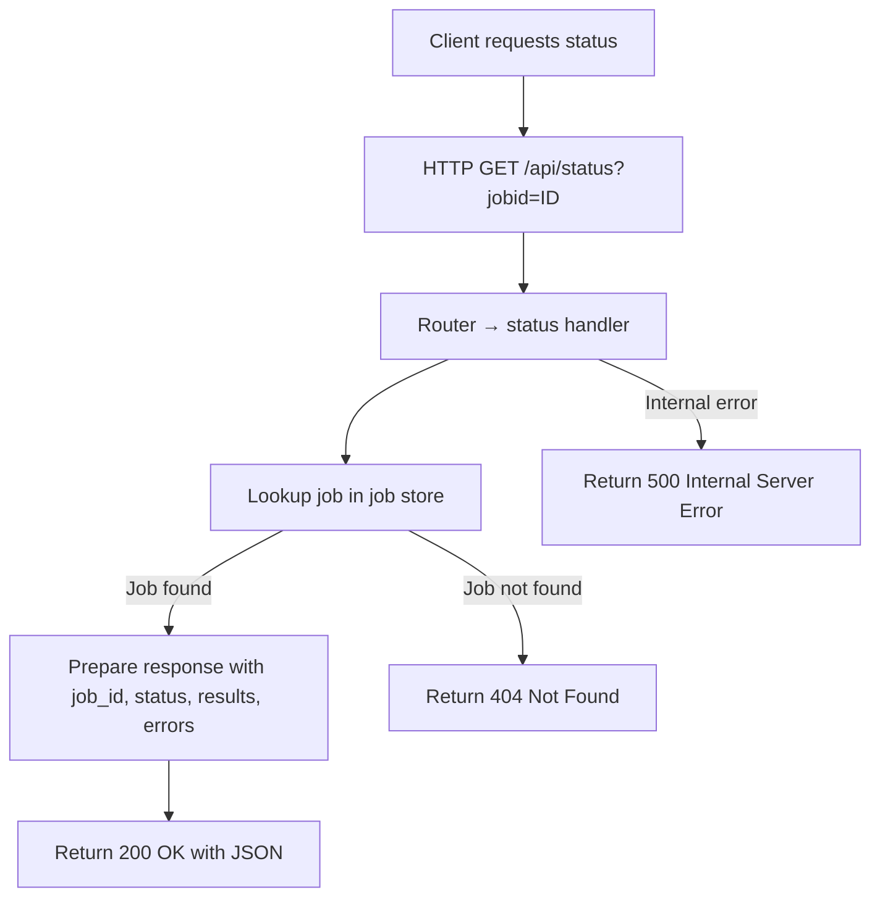

# GET /api/status

## Overview
Retrieves the current status and results of a specific image‑processing job. No authentication is required.

## Request

### URL
`GET /api/status`

### Query Parameters
| Parameter | Type   | Required | Description                                    |
|-----------|--------|----------|------------------------------------------------|
| `jobid`   | integer| Yes      | The unique identifier of the job (allocated sequentially from 1). |

## Authentication
None – the endpoint is publicly accessible.

## Response Schema
The handler returns a JSON object with the following fields:

| Field     | Type          | Description                                                                    |
|-----------|---------------|--------------------------------------------------------------------------------|
| `job_id`  | integer       | The ID of the requested job.                                                   |
| `status`  | string        | Current state of the job. Possible values: <br>`"pending"` – job created, not yet processing <br>`"processing"` – images are being processed <br>`"completed"` – all images processed successfully <br>`"failed"` – job terminated due to errors. |
| `results` | array of numbers | List of calculated perimeters (`2 × [Height + Width]`) for each successfully processed image. Empty array while the job is pending or processing. |
| `errors`  | array of strings   | Any error messages encountered during processing (e.g., missing store, download failure). Empty array when the job succeeds. |

### Example Response (200 OK)
```json
{
  "job_id": 42,
  "status": "completed",
  "results": [123.4, 567.8, 910.2],
  "errors": []
}
```

## Error Codes

| HTTP Code | Description                                   |
|-----------|-----------------------------------------------|
| `404 Not Found`   | The supplied `jobid` does not correspond to any existing job. |
| `500 Internal Server Error` | An unexpected server error occurred while processing the request. |

## Example Usage

**cURL**
```bash
curl -X GET "http://localhost:8080/api/status?jobid=42"
```

## Flow Diagram
The following Mermaid diagram illustrates the status‑retrieval flow:



## Notes
- Job IDs are monotonically increasing integers (1, 2, 3, …) assigned at job creation.
- The endpoint is stateless on the client side; each request reflects the **current** job state.
- While a job is in `pending` or `processing` state, `results` and `errors` may be empty or partially populated. Once the job reaches `completed` or `failed`, these arrays contain the final data.